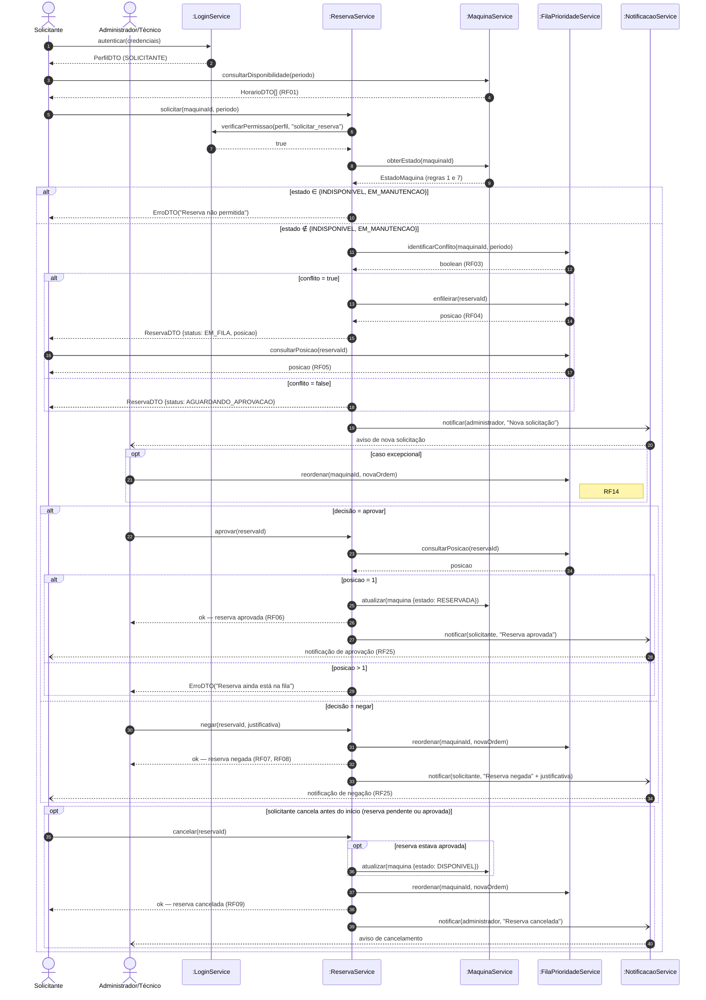
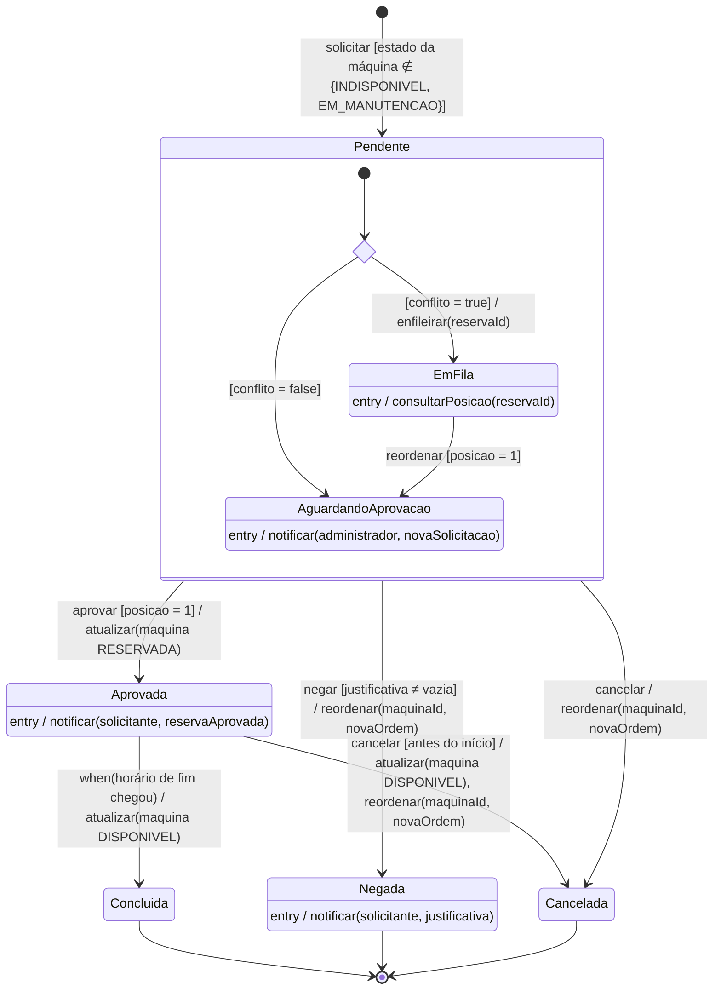
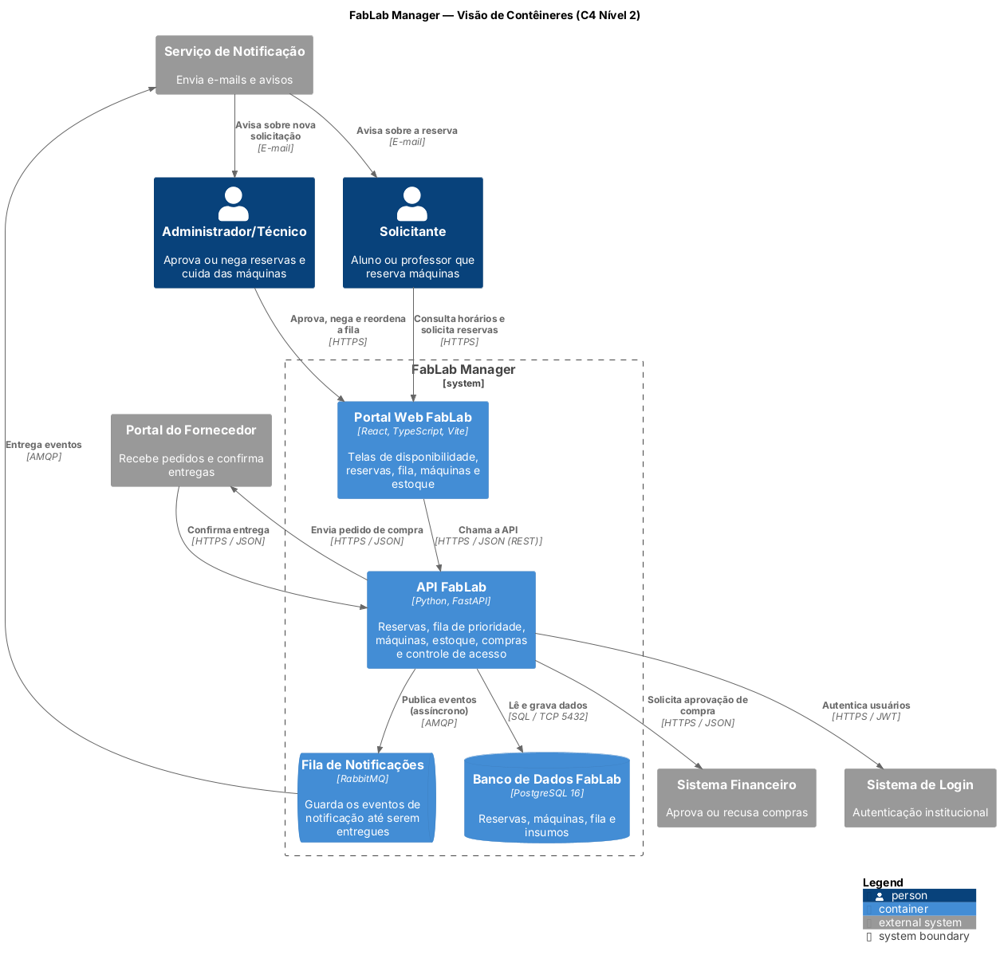
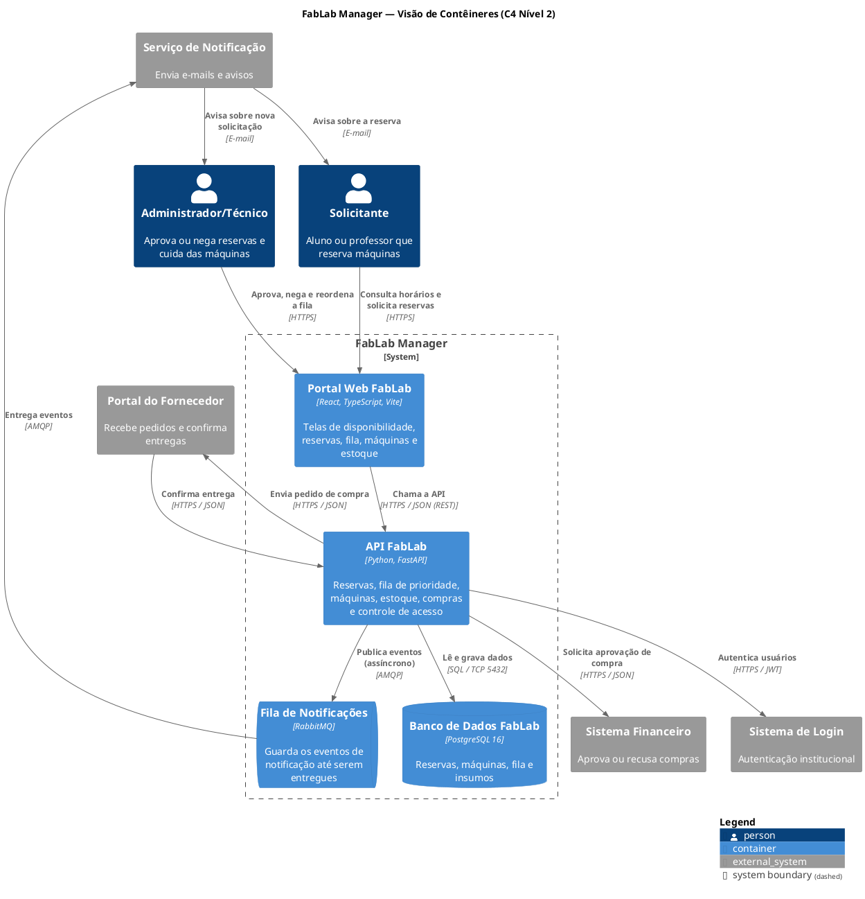

# APS 3 — Dossiê de Arquitetura Viva · FabLab Manager

**Aluno:** Fernando Damasceno
**Unidade curricular:** Modelagem de Software — Engenharia de Software, 4º período (UniSenai)
**Professor:** Sidney L. da Silva
**Funcionalidade escolhida:** Fluxo de Reserva de Máquina com Fila de Prioridade e Aprovação

---

## 1. Sobre a funcionalidade

O FabLab tem poucas máquinas (impressoras 3D, cortadora a laser, CNC etc.) para muitos alunos e professores. Por isso a **reserva de máquina** é a funcionalidade mais crítica do FabLab Manager: se ela falhar, duas pessoas podem ficar com o mesmo horário, alguém pode reservar uma máquina em manutenção ou o aluno pode não ficar sabendo se o pedido foi aceito.

Este dossiê parte da modelagem que a equipe já tinha no repositório `model-storming-fablab` (Diagrama de Sequência da reserva, Diagrama de Interfaces, Diagrama de Atividades e Diagrama de Componentes) e a transforma nos 5 artefatos pedidos na APS 3.

### Requisitos envolvidos

| Requisito | Descrição |
|---|---|
| RF01 | Consultar disponibilidade das máquinas |
| RF02 | Solicitar reserva de máquina |
| RF03 | Identificar conflito de horário |
| RF04 | Criar/atualizar fila de prioridade |
| RF05 | Consultar posição na fila |
| RF06 | Aprovar reserva |
| RF07 / RF08 | Negar reserva com justificativa |
| RF09 | Cancelar reserva |
| RF14 | Reordenar fila de prioridade (caso excepcional) |
| RF25 | Notificar os envolvidos |

**Regras 1 e 7:** não é permitido reservar máquina indisponível ou em manutenção. Nos diagramas isso aparece como a guarda `[estado ∈ {INDISPONIVEL, EM_MANUTENCAO}]`.

### Interfaces usadas (Diagrama de Interfaces da equipe)

Regra de consistência da APS: toda mensagem enviada a uma linha de vida no Diagrama de Sequência é uma operação pública da interface dela. Todas as operações abaixo já existiam no Diagrama de Interfaces do projeto.

| Linha de vida | Interface | Operações usadas |
|---|---|---|
| `:LoginService` | `IAutenticacao` | `autenticar(credenciais)`, `verificarPermissao(perfil, funcionalidade)` |
| `:MaquinaService` | `IMaquinaService` | `consultarDisponibilidade(periodo)`, `obterEstado(maquinaId)`, `atualizar(maquina)` |
| `:ReservaService` | `IReservaService` | `solicitar(maquinaId, periodo)`, `aprovar(reservaId)`, `negar(reservaId, justificativa)`, `cancelar(reservaId)` |
| `:FilaPrioridadeService` | `IFilaPrioridade` | `identificarConflito(maquinaId, periodo)`, `enfileirar(reservaId)`, `consultarPosicao(reservaId)`, `reordenar(maquinaId, novaOrdem)` |
| `:NotificacaoService` | `INotificacao` | `notificar(destinatario, evento)` |

As entidades devolvidas pelas interfaces (`Perfil`, `Horario`, `Reserva`) trafegam como DTOs: `PerfilDTO`, `HorarioDTO` e `ReservaDTO`. Erros de regra de negócio voltam como `ErroDTO`.

---

## 2. Artefato 1 — Diagrama de Sequência

Arquivo: [`docs/diagrams/sequencia.mmd`](docs/diagrams/sequencia.mmd)

Continuação do Diagrama de Sequência "Reserva de Máquina" da equipe: o solicitante faz login, consulta horários e pede a reserva; o técnico aprova ou nega; e o solicitante pode cancelar antes do início. A linha de vida única "FabLab" do diagrama original foi separada nos serviços do Diagrama de Interfaces, para que cada mensagem corresponda a uma operação declarada.

- **Chamadas síncronas (`->>`):** quem chama espera a resposta, por exemplo `solicitar(...)` e `obterEstado(...)`.
- **Chamadas assíncronas (`-)`, seta assíncrona do Mermaid):** o `ReservaService` envia `notificar(...)` e segue sem esperar, porque a notificação passa pela fila de mensagens (ver ADR 0001). A entrega ao ator também é assíncrona (`--)`).
- **Fragmentos combinados:**
  - `alt/else`: máquina indisponível ou em manutenção, conflito de horário, decisão do técnico e reserva ainda na fila na hora de aprovar;
  - `opt`: reordenação excepcional da fila (RF14), cancelamento pelo solicitante (RF09) e liberação da máquina quando a reserva cancelada estava aprovada.
- **DTOs no retorno:** `PerfilDTO`, `HorarioDTO[]`, `ReservaDTO` e `ErroDTO`.



---

## 3. Artefato 2 — Diagrama de Atividades com Raias

Arquivo: [`docs/diagrams/atividades.mmd`](docs/diagrams/atividades.mmd)

Baseado no Diagrama de Atividades "Processo de Reserva" da equipe, com as mesmas atividades e os mesmos RFs.

- **4 raias:** Solicitante, Sistema FabLab, Administrador/Técnico e Serviço de Notificação.
- **Nós de decisão com guardas mutuamente exclusivas:**

| Decisão | Guardas |
|---|---|
| Máquina pode ser reservada? (regras 1 e 7) | `[estado ∈ {INDISPONIVEL, EM_MANUTENCAO}]` / `[estado ∉ {INDISPONIVEL, EM_MANUTENCAO}]` |
| Há conflito de horário? (RF03) | `[conflito = true]` / `[conflito = false]` |
| Caso excepcional? (RF14) | `[caso excepcional = true]` / `[caso excepcional = false]` |
| Aprovar reserva? | `[decisão = aprovar]` / `[decisão = negar]` |
| Cancelar? (RF09) | `[cancelar = true]` / `[cancelar = false]` |

- **Fork e Join (barras pretas):** quando a reserva é aprovada, o sistema **atualiza o estado da máquina para reservada** e, em paralelo, o Serviço de Notificação **avisa o solicitante**. As duas tarefas não dependem uma da outra; o join espera as duas terminarem antes de o solicitante receber a aprovação.
- **Negação:** o técnico nega, o sistema registra a justificativa (RF08), atualiza a fila e o solicitante é notificado.
- **Cancelamento (RF09):** depois de aprovado, o solicitante pode cancelar; o sistema libera o horário e atualiza a fila.

```mermaid
flowchart TB
    subgraph SOL["Solicitante"]
        INI(( )):::inicio
        A1["Autenticar"]
        A2["Consultar disponibilidade (RF01)"]
        A3["Solicitar reserva (RF02)"]
        A4["Consultar posição na fila (RF05)"]
        A5["Receber aprovação"]
        D5{ }
        A6["Cancelar reserva (RF09)"]
        A7["Receber negação e justificativa"]
        FIM1((( ))):::fim
        FIM2((( ))):::fim
        FIM3((( ))):::fim
        FIM4((( ))):::fim
    end

    subgraph SIS["Sistema FabLab"]
        D1{ }
        B1["Informar reserva não permitida"]
        D2{ }
        B2["Criar/atualizar fila de prioridade (RF04)"]
        M1{ }
        B3["Encaminhar para aprovação"]
        FK1["fork"]:::barra
        B4["Atualizar estado da máquina para reservada"]
        JN1["join"]:::barra
        B5["Registrar justificativa (RF08)"]
        B7["Atualizar fila de prioridade"]
        B6["Liberar horário e atualizar fila"]
    end

    subgraph ADM["Administrador/Técnico"]
        D3{ }
        C1["Reordenar fila (RF14)"]
        M2{ }
        D4{ }
        C2["Aprovar reserva (RF06)"]
        C3["Negar reserva (RF07)"]
    end

    subgraph NOT["Serviço de Notificação"]
        E1["Avisar administrador"]
        E2["Notificar aprovação (RF25)"]
        E3["Notificar negação com justificativa (RF25)"]
    end

    INI --> A1 --> A2 --> A3 --> D1
    D1 -->|"[estado ∈ {INDISPONIVEL, EM_MANUTENCAO}]"| B1 --> FIM1
    D1 -->|"[estado ∉ {INDISPONIVEL, EM_MANUTENCAO}]"| D2
    D2 -->|"[conflito = true]"| B2 --> A4 --> M1
    D2 -->|"[conflito = false]"| M1
    M1 --> B3 --> E1 --> D3
    D3 -->|"[caso excepcional = true]"| C1 --> M2
    D3 -->|"[caso excepcional = false]"| M2
    M2 --> D4
    D4 -->|"[decisão = aprovar]"| C2 --> FK1
    FK1 --> B4 --> JN1
    FK1 --> E2 --> JN1
    JN1 --> A5 --> D5
    D5 -->|"[cancelar = false]"| FIM2
    D5 -->|"[cancelar = true]"| A6 --> B6 --> FIM3
    D4 -->|"[decisão = negar]"| C3 --> B5 --> B7 --> E3 --> A7 --> FIM4

    classDef inicio fill:#111,stroke:#111
    classDef fim fill:#111,stroke:#111,stroke-width:3px
    classDef barra fill:#111,stroke:#111,color:#fff,font-size:10px
```



---

## 4. Artefato 3 — Diagrama de Transição de Estados (Reserva)

Arquivo: [`docs/diagrams/estados.mmd`](docs/diagrams/estados.mmd)

Ciclo de vida da entidade **Reserva**:

- **Estado inicial** `[*]` e **estados terminais** `Concluida`, `Negada` e `Cancelada`.
- **Subestados:** o estado `Pendente` tem dentro dele `EmFila` e `AguardandoAprovacao`. O losango de escolha decide entre os dois conforme o conflito de horário.
- **Transições no formato `Gatilho [Condição] / Ação()`**, por exemplo:
  - `aprovar [posicao = 1] / atualizar(maquina RESERVADA)`
  - `negar [justificativa ≠ vazia] / reordenar(maquinaId, novaOrdem)`
  - `cancelar [antes do início] / atualizar(maquina DISPONIVEL), reordenar(maquinaId, novaOrdem)`
- **Ações internas (`entry /`)** em `AguardandoAprovacao`, `EmFila`, `Aprovada` e `Negada`.
- **Gatilhos:** `solicitar`, `aprovar`, `negar`, `cancelar` e `reordenar` são operações do Diagrama de Interfaces. `when(horário de fim chegou)` é um evento de tempo da UML, que encerra a reserva aprovada.

**Proteção contra estados inválidos:**

- uma reserva em fila só pode ser aprovada quando chega à posição 1 (na sequência, o `alt posicao = 1 / posicao > 1`);
- a negação só acontece com justificativa (RF08);
- `Negada`, `Cancelada` e `Concluida` são finais: nenhuma transição sai delas;
- máquina indisponível ou em manutenção nem chega a criar a reserva.



---

## 5. Artefato 4 — Visão de Contêineres (C4 Nível 2)

Arquivos:

- [`docs/architecture/c4-conteineres.puml`](docs/architecture/c4-conteineres.puml): modelo em **C4-PlantUML** (`.puml`), como pede o Artefato 4.
- [`docs/architecture/workspace.dsl`](docs/architecture/workspace.dsl): arquivo exigido pela estrutura de entrega. Ele apenas inclui o `.puml` (`!include`), então os dois geram o mesmo diagrama e não há duas versões para manter.

A visão segue o Diagrama de Componentes da equipe: o **Portal Web FabLab** (apresentação), a camada de negócio (Reservas, Fila de Prioridade, Máquinas e Manutenção, Estoque, Compras, Notificações e Controle de Acesso), que no C4 forma o contêiner **API FabLab**, e o **Banco de Dados FabLab**, com os mesmos sistemas externos (Sistema de Login, Serviço de Notificação, Sistema Financeiro e Portal do Fornecedor). O contêiner novo é a **Fila de Notificações (RabbitMQ)**, explicada na ADR 0001.



| Contêiner | Tecnologia | Comunicação |
|---|---|---|
| Portal Web FabLab | React, TypeScript, Vite | HTTPS / JSON (REST) com a API |
| API FabLab | Python, FastAPI | SQL com o banco · AMQP com a fila · HTTPS com os sistemas externos |
| Banco de Dados FabLab | PostgreSQL 16 | SQL / TCP 5432 |
| Fila de Notificações | RabbitMQ | AMQP |



---

## 6. Artefato 5 — ADR 0001

Arquivo: [`docs/architecture/adr-0001.md`](docs/architecture/adr-0001.md)

**ADR 0001 — Notificações assíncronas com fila de mensagens (RabbitMQ).** Status: Aprovado.

Resumo: em vez de a API chamar o Serviço de Notificação e esperar a resposta, ela publica um evento numa fila do RabbitMQ e responde na hora. Assim, se o Serviço de Notificação estiver lento ou fora do ar, aprovar, negar ou cancelar uma reserva continua funcionando, e os avisos ficam guardados na fila até serem entregues.

---

## 7. Consistência entre os modelos

Cada passo do fluxo aparece com o mesmo nome nos diagramas:

| Passo | Atividades | Sequência | Estados |
|---|---|---|---|
| Solicitar | Solicitar reserva (RF02) | `solicitar(maquinaId, periodo)` | `[*] → Pendente : solicitar [...]` |
| Regras 1 e 7 | Decisão `[estado ∈ {INDISPONIVEL, EM_MANUTENCAO}]` | `obterEstado(maquinaId)` + `alt` | guarda `[estado da máquina ∉ {INDISPONIVEL, EM_MANUTENCAO}]` |
| Conflito | Decisão `[conflito = true/false]` | `identificarConflito(...)` + `alt` | escolha `[conflito = true/false]` |
| Entrar na fila | Criar/atualizar fila (RF04) | `enfileirar(reservaId)` | `/ enfileirar(reservaId)` → `EmFila` |
| Posição na fila | Consultar posição (RF05) | `consultarPosicao(reservaId)` | `EmFila : entry / consultarPosicao(reservaId)` |
| Avisar técnico | Avisar administrador | `notificar(administrador, ...)` assíncrono | `AguardandoAprovacao : entry / notificar(administrador, ...)` |
| Caso excepcional | Reordenar fila (RF14) | `opt reordenar(...)` | `EmFila → AguardandoAprovacao : reordenar [posicao = 1]` |
| Aprovar | Aprovar reserva (RF06) + fork/join | `aprovar(reservaId)` + `alt posicao = 1` | `Pendente → Aprovada : aprovar [posicao = 1]` |
| Máquina reservada | Atualizar estado da máquina para reservada | `atualizar(maquina {estado: RESERVADA})` | `/ atualizar(maquina RESERVADA)` |
| Notificar aprovação | Notificar aprovação (RF25) | `notificar(solicitante, ...)` assíncrono | `Aprovada : entry / notificar(solicitante, ...)` |
| Negar | Negar (RF07), Registrar justificativa (RF08), Atualizar fila | `negar(reservaId, justificativa)` + `reordenar(...)` | `Pendente → Negada : negar [justificativa ≠ vazia] / reordenar(...)` |
| Notificar negação | Notificar negação com justificativa (RF25) | `notificar(solicitante, ...)` assíncrono | `Negada : entry / notificar(solicitante, justificativa)` |
| Cancelar | Cancelar reserva (RF09), Liberar horário e atualizar fila | `opt cancelar(reservaId)` + `atualizar(...)` + `reordenar(...)` | `Pendente → Cancelada` e `Aprovada → Cancelada : cancelar [antes do início] / ...` |

---

## 8. Estrutura do repositório

```
aps3-fernando-damasceno/
├── docs/
│   ├── architecture/
│   │   ├── workspace.dsl         ← inclui o c4-conteineres.puml
│   │   ├── c4-conteineres.puml   ← C4 Nível 2 em C4-PlantUML
│   │   ├── c4-conteineres.png    ← imagem gerada a partir do .puml
│   │   └── adr-0001.md           ← Registro de Decisão Arquitetural
│   └── diagrams/
│       ├── sequencia.mmd
│       ├── atividades.mmd
│       └── estados.mmd
└── README.md
```

Os diagramas Mermaid são renderizados direto pelo GitHub neste README. O GitHub não renderiza PlantUML, por isso o C4 aparece também como imagem. Para gerá-la de novo: `java -jar plantuml.jar docs/architecture/c4-conteineres.puml`.
